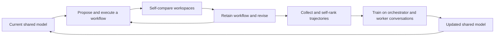

# MASS Guide

### A reading companion to *Recursive Self-Improvement through Multi-Agent Self-Supervision*

**Paper authors: Hyunin Lee, Jinglue Xu, Jeffrey Seely, Donghyun Lee, Somayeh Sojoudi, Matei Zaharia, and Yujin Tang.**

[Paper v1](https://arxiv.org/abs/2610.12176v1) · [Full PDF](https://arxiv.org/pdf/2610.12176v1) · [Accessible HTML](https://arxiv.org/html/2610.12176v1) · [Authors' code](https://github.com/SakanaAI/mass) · [Authors' project page](https://pub.sakana.ai/mass/)

An unofficial, independently authored guide to the 39-page arXiv preprint **2610.12176v1**, submitted **8 October 2026**. It explains the method, records the reported evidence, and makes the paper easier to navigate for people and agents. The research and MASS method belong to the authors above. `0xHayd3n` maintains this companion; the maintainer is not a paper author. No author endorsement is implied.

**Research status:** reading notes only. No training, benchmark runs, or experiment reproduction was performed here. Use the [authors' repository](https://github.com/SakanaAI/mass) for their implementation. This repository contains no paper PDF, extracted full text, copied figures, model weights, or research implementation.

## Start here

| Your goal | Reading route |
| --- | --- |
| Understand the idea in five minutes | [Core idea](#the-core-idea) → [Reported findings](#reported-findings) → [Qualifications](#qualifications-that-change-the-reading) |
| Read the paper deeply | [Paper map](notes/01-paper-map.md) → [Method and notation](notes/02-method-and-notation.md) → [Results](notes/03-results.md) |
| Assess the evidence | [Results](notes/03-results.md) → [Limitations](notes/04-limitations.md) → [Figure and table guide](notes/06-figures-and-tables.md) |
| Understand the concrete workflows | [Workflow examples](notes/05-workflow-examples.md) → paper Appendices H–I |
| Retrieve facts as an agent | [AGENTS.md](AGENTS.md) → [metadata/paper.json](metadata/paper.json) → [metadata/claims.json](metadata/claims.json) → cited note |
| Cite or reuse material | [Citation](#citation) → [Attribution](ATTRIBUTION.md) → [Licence scope](LICENSE.md) |

## The core idea

MASS asks whether a model can improve using supervision from copies of itself. When overall research quality has no reliable automatic verifier, a model's own critiques can repeat the same mistakes as its original answer. The authors try to make that self-supervision more useful by changing how the model works: divide a long task among bounded specialist roles, specify what each role must return, route those artifacts through a workflow, and train the shared model on the resulting execution conversations. (§§1–3, PDF pp. 2–5.)

The method has two alternating stages:

1. **Search with fixed weights.** The current model proposes a multi-agent workflow, runs it, compares the produced workspace with the retained workspace, and revises the workflow using its own feedback. The retained workflow is the best seen under these self-comparisons.
2. **Learn from selected executions.** The same model generates multiple trajectories using the retained workflow. Its comparisons rank the resulting workspaces. Selected orchestrator and worker conversations become supervised fine-tuning data. The initial orchestrator workflow instruction is removed from the training input, so the student must learn when and how to coordinate from the bare task.

The updated model then serves as executor, workflow optimizer, and in-loop evaluator in the next cycle. The reported experiment completes two cycles, starting from Qwen3.6-27B. (§3, Algorithm 1, PDF pp. 4–5; Appendix A, p. 15.)



*Original explanatory diagram based on paper §3 and Appendix A. The loop arrows show the procedure, not a guarantee of increasing performance.*

## What is being optimized?

A workflow is a textual specification appended to a task. Its components are the **role**, **instruction**, **output contract**, and **hop**. The output contract defines what a worker returns; the hop defines call order. The optimizer emphasizes contracts and routing, rather than merely adding more agents or lengthening a reasoning trace. The agent scaffold and tools stay fixed while prompts are searched and model weights are subsequently updated. (§§2–3, PDF pp. 3–5.)

This separation matters: searching a better prompt does not itself train a better model, and collecting team traces does not establish that a later student was trained. MASS reports both prompt-level search and actual weight updates. “Optimal” workflow means the best retained under the search's self-judgments, with no global-optimality certificate. See [method and notation](notes/02-method-and-notation.md).

## Reported findings

Every number below is **reported by the paper**, not measured by this repository. `L0` is the base model; `L1` and `L2` follow one and two MASS cycles. Public-benchmark values follow **Appendix C.5, Table 7 (PDF pp. 20–22)**, including its units and trial counts. Differences elsewhere in v1 are recorded in the [source discrepancies](notes/04-limitations.md#source-discrepancies).

| Public benchmark | Tasks × trials per model | Metric | L0 | L1 | L2 |
| --- | --- | --- | --- | --- | --- |
| ScienceAgentBench | 102 × 3 | Success, % | 28.8 ± 1.5 | 30.4 ± 2.0 | 31.7 ± 2.0 |
| MLR-Bench subset | 12 × 5 | Overall score, aggregate 0–10 | 1.58 ± 0.38 | 1.80 ± 0.30 | 2.40 ± 0.28 |
| AstaBench E2E-Bench-Hard | 40 × 3 | Rubric score | 0.053 ± 0.002 | 0.055 ± 0.004 | 0.067 ± 0.017 |
| DSBench | 74 × 3 | Normalized score | 0.473 ± 0.029 | 0.465 ± 0.011 | 0.482 ± 0.025 |
| Terminal-Bench 2.0 | 89 × 3 scheduled | Pass, % | 37.5 ± 2.2 | 35.3 ± 2.1 | 35.2 ± 1.7 |
| SWE-bench Verified | 500 × 3 scheduled | Pass, % | 62.6 ± 1.4 | 61.8 ± 1.9 | 61.1 ± 0.6 |

`±` is the sample standard deviation of trial means, not a confidence interval. Terminal-Bench uses 86/88/87 common-result tasks across its trials; SWE-bench uses 499/499/496. The paper's “1.2–1.6×” headline is the **ratio of score per output token**, L2 versus L0, on the four research benchmarks: ScienceAgentBench 1.20×, MLR-Bench 1.60×, AstaBench 1.28×, and DSBench 1.35× (Figure 2, PDF p. 3). It is not a uniform raw-score multiplier, a wall-clock speedup, or a total-compute reduction. The software benchmarks' corresponding ratios are 0.96× and 0.94×.

Other reported evidence:

- **Private held-out tasks:** L1 wins 53.9% and L2 69.9% of non-tied external judgments against L0 across three held-out synthetic tasks; L2 wins 60.8% against L1. Six judgments evaluate each workspace pair, rather than representing six independent executions. (§4.2; Appendix C.1–C.2.)
- **Training-token comparison:** the main first-cycle student `M+` wins 68.3% against the base across four shared training tasks plus one test task, using 28.82M processed supervised tokens. `S++` wins 64.0% using 42M. The paper summarizes this as about 1.4× more tokens for the single-agent control; the displayed budgets imply about 1.46×. Data coverage, sampling, and checkpoint selection differ, so this is not an isolated causal effect of team supervision. (§4.4; Appendix D.)
- **Transfer across roles:** evaluator agreement with the external panel rises 0.73 → 0.91 → 0.93. Base-model executions of L1-discovered workflows beat base-model executions of L0-discovered workflows at a mean win share of 0.64. This fixes execution weights for the transfer comparison, but discovery also used different generation-specific executors and evaluators. (§4.2; Table 1; Appendix C.3.)
- **Behavior under bare prompts:** delegation occurs in 1/110, 48/110, and 87/110 episodes across L0/L1/L2; recorded code handoffs occur in 1/110, 42/110, and 83/110. These are structural events, not proof the scientific work is correct. (§5.2; Table 2; Appendix G.)

## Qualifications that change the reading

The paper offers evidence for a useful self-supervision loop in a specific experimental setting. Two cycles do not establish indefinite self-improvement or formally guaranteed progress. The private benchmark has 12 tasks, nine designated for training, eight contributing first-cycle SFT data, and three held out from post-training. The main student has 119 selected teacher trajectories. External models report workspace preferences; those preferences can favor scientifically invalid revisions. (§4.1; Appendices B–C, G, J.)

Completion explains part of the research-benchmark improvement. MLR-Bench paper delivery increases 31/60 → 50/60 and AstaBench report delivery 60/120 → 91/120. Scores among delivered artifacts are lower in the later generation, but those conditional averages cover different completed sets. They cannot establish a decline in quality on a matched set. No MLR-Bench execution calls the delegation tool. Its aggregate improvement therefore does not establish delegation as the transfer mechanism. (Appendix C.5, PDF pp. 20–21.)

The information-flow analysis measures embeddings of workflow descriptions. It supports changes in task specificity and redundancy, but does not directly measure executed messages or identify the causal mechanism of learning. The teacher controls also differ in training coverage and sampling. These qualifications are essential to reading the headline numbers. See [limitations and open questions](notes/04-limitations.md).

## Contents

```text
README.md                       entry point and headline evidence
AGENTS.md                       retrieval and editing rules for agents
notes/01-paper-map.md            section-by-section navigation
notes/02-method-and-notation.md  algorithms, notation, and training details
notes/03-results.md              results, denominators, and token accounting
notes/04-limitations.md          qualifications and v1 discrepancies
notes/05-workflow-examples.md    task and workflow interpretation
notes/06-figures-and-tables.md   visual evidence reading guide
metadata/paper.json              canonical identity and source provenance
metadata/claims.json             structured claims with scope and caveats
metadata/results.json            reported numerical tables
references/paper.bib             version-pinned BibTeX
CITATION.cff                    preferred citation to the actual paper
ATTRIBUTION.md / LICENSE.md      credit and scoped reuse terms
CONTRIBUTING.md                  correction and review conventions
scripts/check_repository.py     offline documentation integrity checks
```

Read offline with `git clone https://github.com/0xHayd3n/mass-guide.git`. The explanatory material needs no model access or GPU. Run `python scripts/check_repository.py` to check local navigation, metadata, and citation consistency; that command does not test or reproduce MASS.

## Citation

Please cite the research authors when referring to MASS:

> Hyunin Lee, Jinglue Xu, Jeffrey Seely, Donghyun Lee, Somayeh Sojoudi, Matei Zaharia, and Yujin Tang. 2026. *Recursive Self-Improvement through Multi-Agent Self-Supervision*. arXiv:2610.12176v1, 8 October 2026. https://arxiv.org/abs/2610.12176v1

Use [references/paper.bib](references/paper.bib) or [CITATION.cff](CITATION.cff). arXiv lists `10.48550/arXiv.2610.12176` as an arXiv-issued DOI pending registration at the verification date; the exact-version arXiv link is the primary identifier here.

## Attribution and provenance

Hyunin Lee, Donghyun Lee, Somayeh Sojoudi, and Matei Zaharia are affiliated with UC Berkeley in the paper; Jinglue Xu, Jeffrey Seely, and Yujin Tang with Sakana AI. Hyunin Lee's work was done during a Sakana AI internship. The author list and version were checked against the attachment's opening pages and the [arXiv record](https://arxiv.org/abs/2610.12176v1).

The complete public v1 PDF was read, including Appendices A–J, and relevant figures/tables were inspected as rendered pixels. The supported attachment transfer encountered a Windows metadata limitation; reading used an independent exact-version public PDF. Title, authors, page count, and version match the attachment text. **Attachment/public-PDF byte equality was not established.** The verified public PDF's SHA-256 and size are recorded in [metadata/paper.json](metadata/paper.json).

The paper is [CC BY 4.0](https://creativecommons.org/licenses/by/4.0/) according to arXiv. This repository distributes original explanations and factual transcriptions with source references, while linking to the full source. Its [licence](LICENSE.md) covers only original companion material. The linked paper, official code, and other third-party material retain their own rights and terms. See [ATTRIBUTION.md](ATTRIBUTION.md) for the complete notice. Metadata and external links last checked **12 October 2026**.
